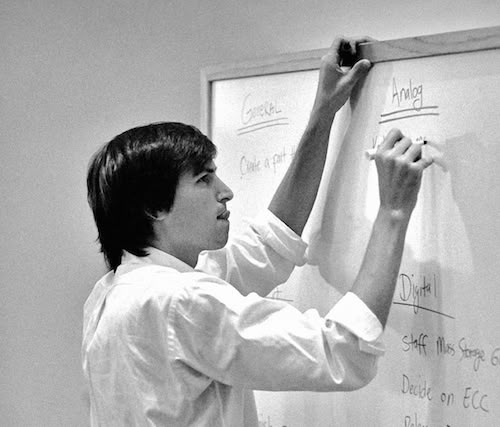

# Beyond Code, Building What's Possible.

  

### Creative Technologist · Tech Entrepreneur

I'm a Computer Science student passionate about **building useful products, solving problems, and turning ideas into working software.**

My interests sit at the intersection of **web development, artificial intelligence, and product design**. I learn by building, experimenting, and developing solutions that solve real problems and improve user experiences.

---

## Current Work & Initiatives

### Project Astra

**Project ASTRA is an emerging research and technology initiative driven by curiosity, scientific exploration, and engineering innovation.**

We are a team of individuals brought together by a shared interest in technology, space science, and the possibilities that lie beyond our planet.

Our initiative represents an opportunity to explore ideas beyond conventional boundaries, connect scientific curiosity with technological thinking.

 

### Technology Research & Innovation

I actively explore emerging technologies, software architecture, and new approaches to solving technical problems. My interests include understanding how technologies work, experimenting with new tools, and exploring ideas that can lead to practical applications.

I believe research and experimentation are essential to building better technology. I aim to keep learning, testing ideas, and contributing to the broader technology ecosystem.

 

## Entrepreneurship & Innovation

I'm deeply interested in technology entrepreneurship, product thinking, and building sustainable technology-driven ventures.

I enjoy identifying opportunities, understanding real-world problems, and exploring how innovative ideas can become useful products. For me, entrepreneurship is about combining technical knowledge, creativity, and strategic thinking to create solutions with real-world value.

**National Business Idea Pitching Contest '26 — Finalist**

 

---

## What I'm Working Toward

My goal is to become a strong **problem solver and software developer** who combines creativity with logic to build genuinely useful technology.

I believe the best way to learn is to **build, break, improve, and build again.**

## Beyond Coding

I enjoy exploring emerging technologies, brainstorming product ideas, experimenting with new tools, and sharing what I learn.

🌱 **Always learning. Always building. Always improving.**

---

## Find Me Around the Web

- **Portfolio:** [princetimilsina.com.np](https://princetimilsina.com/)
- **Email:** [timilsinaprince.js@gmail.com](mailto:timilsinaprince.js@gmail.com)
